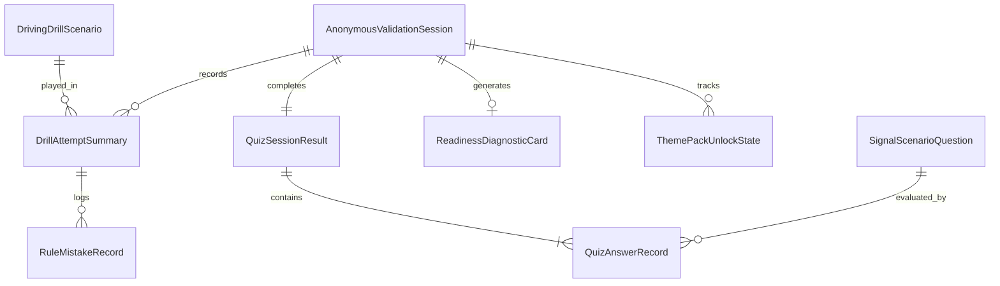
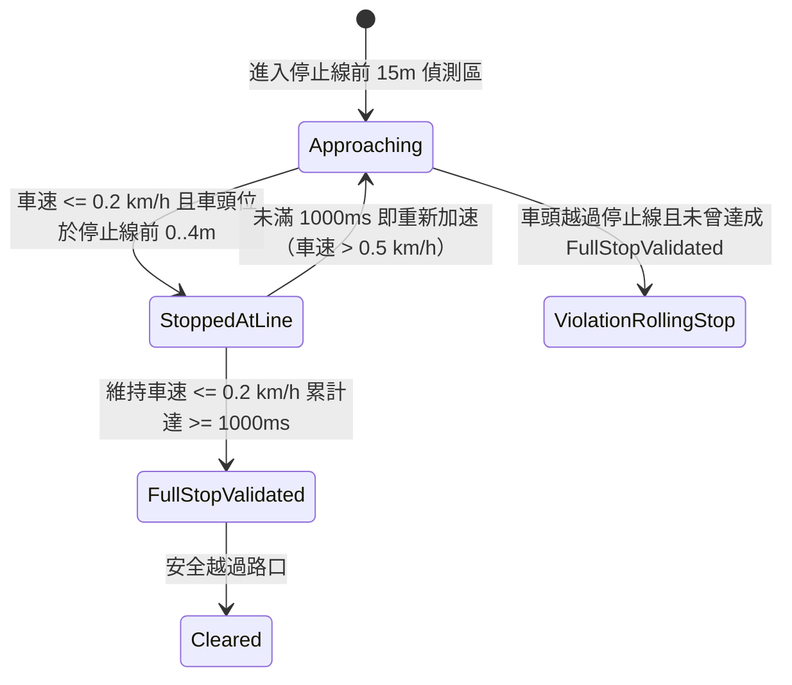

# Data Model: 台灣赴日自駕右駕認知與號誌演練工具 (`001-japan-rhd-trainer`)

**Date**: 2026-11-27
**Feature**: [spec.md](./spec.md)
**Research Reference**: [research.md](./research.md)

本文件定義系統之領域實體、欄位型別、驗證規則與核心交通規則狀態轉換，嚴格對齊 `spec.md` 之 6 個 Key Entities 與憲章原則 V（純領域邏輯與 UI／3D 渲染解耦）。

---

## 1. 領域實體關係總覽（ER Diagram）

---

## 2. 核心實體定義（Entities & Validation Rules）

### 2.1 `SignalScenarioQuestion`（號誌情境題 — 靜態模組化資料）

對應需求：`FR-003`、`FR-004`

| 欄位 | 型別 | 必填 | 說明與驗證規則 |
|------|------|------|----------------|
| `id` | `string` | 是 | 唯一題目識別碼（如 `sig-01-horizontal-order`、`sig-03-red-with-arrows`），格式 `^sig-\d{2}-[a-z0-9-]+$`。 |
| `order` | `number` | 是 | 題目顯示順序（整數 `1..10`；整套題庫總題數必須介於 `8..10` 之間）。 |
| `category` | `'horizontal-order' \| 'arrow-signal' \| 'red-no-turn' \| 'stop-sign' \| 'pedestrian-yield'` | 是 | 台日差異考點分類，題庫必須完整覆蓋此 5 類。 |
| `prompt` | `string` | 是 | 繁體中文路口情境描述（例如：「你正準備在沖繩那霸市區路口右轉，前方號誌如下⋯」）。 |
| `signalPhases` | `SignalPhaseKeyframe[]` | 是 | 動態燈號序列（至少 1 個狀態，動態變化題含 2–3 個時間關鍵幀），定義主燈配置（橫排綠左紅右）、亮燈狀態（`green \| yellow \| red \| off`）及下排箭頭燈（`left \| straight \| right` 陣列）。 |
| `auxiliarySign` | `'tomare' \| 'one-way' \| 'none'` | 是 | 路口輔助標誌（`tomare` 代表紅倒三角「止まれ」）。 |
| `contextActors` | `{ oncomingCar: boolean; pedestrianCrossing: boolean }` | 是 | 周邊動態干擾條件（是否有對向直行車或斑馬線行人）。 |
| `options` | `QuestionOption[]` | 是 | 3–4 個可選決策行動，每項含 `id` 與 `label`；嚴格限制僅有 1 個正確選項。 |
| `correctOptionId` | `string` | 是 | 必須存在於 `options[].id` 中。 |
| `ruleExplanation` | `string` | 是 | 作答後即時顯示之日本道路交通法規解析（明確對比台灣習慣差異）。 |

---

### 2.2 `DrivingDrillScenario`（駕駛實戰微關卡 — 靜態模組化資料）

對應需求：`FR-005`、`FR-007`、`FR-008`、`FR-009`

| 欄位 | 型別 | 必填 | 說明與驗證規則 |
|------|------|------|----------------|
| `id` | `'warmup-range' \| 'urban-drill-1' \| 'urban-drill-2'` | 是 | MVP 固定 3 個可執行關卡識別碼。 |
| `title` | `string` | 是 | 關卡名稱（如「駕訓熱身場：靠左與撥桿反射」、「市區實戰 1：止まれ停讓與多車道右轉」）。 |
| `tier` | `'warmup' \| 'urban-core' \| 'urban-bonus'` | 是 | `warmup` 與 `urban-core` 預設開放；`urban-bonus`（市區實戰第 2 關）預設待旅伴分享解鎖。 |
| `targetDurationSec` | `number` | 是 | 目標完成秒數（`45..120` 秒，確保首套總體驗落在 3–5 分鐘 `SC-002`）。 |
| `checkpoints` | `DrillCheckpoint[]` | 是 | 依序排列之道路決策節點，每節點定義類型（`keep-left-corridor`、`left-turn-small`、`right-turn-wide`、`tomare-stop-line`、`arrow-signal-right-turn`）、燈號時序、對向車／斑馬線行人觸發時機及目標車道（固定為左側順向車道 `left-inbound`）。 |
| `semiAssistBounds` | `{ maxLateralOffsetMeters: number; autoRecenterStrength: number }` | 是 | 半輔助轉向容錯參數（限制車輛最大橫向偏移，防止衝出路面卡死 `FR-007`）。 |

---

### 2.3 `RuleMistakeRecord`（規則失誤紀錄 — 執行期與本機狀態）

對應需求：`FR-006`、`FR-009`、`FR-014`

| 欄位 | 型別 | 必填 | 說明與驗證規則 |
|------|------|------|----------------|
| `mistakeType` | `MistakeType` | 是 | 枚舉值：`'wiper-mistrigger'`（左側誤觸雨刷）、`'tomare-rolling-stop'`（止まれ未完全靜止滿 1 秒）、`'wrong-way-lane'`（轉彎誤入右側逆向車道）、`'signal-violation'`（箭頭／紅綠燈號誌誤判搶行）、`'yield-violation'`（未禮讓對向直行車或斑馬線行人）。 |
| `scenarioId` | `string` | 是 | 發生失誤之關卡或題目 ID。 |
| `checkpointId` | `string` | 否 | 駕駛關卡內之具體路口節點 ID。 |
| `attemptNumber` | `number` | 是 | 該使用者於該關卡之第幾次嘗試（整數 `>= 1`；`1` 為首次基準線，`>= 2` 用於計算 `SC-003` 重複練習失誤降幅）。 |
| `elapsedMs` | `number` | 是 | 距離關卡開始之毫秒數（`>= 0`）。 |

---

### 2.4 `DrillAttemptSummary` & `QuizSessionResult`（練習結算紀錄）

對應需求：`FR-004`、`FR-014`、`SC-002`、`SC-003`

- **`QuizSessionResult`**：
  - `totalQuestions`: `number` (`8..10`)
  - `correctCount`: `number` (`0..totalQuestions`)
  - `durationMs`: `number` (`> 0`)
  - `weakCategories`: `SignalCategory[]`（答錯題目所屬分類集合）
  - `completedAt`: `string`（ISO 8601 時間戳記）
- **`DrillAttemptSummary`**：
  - `scenarioId`: `'warmup-range' | 'urban-drill-1' | 'urban-drill-2'`
  - `attemptNumber`: `number` (`>= 1`)
  - `completed`: `boolean`
  - `durationMs`: `number`
  - `totalMistakes`: `number`（四項核心右駕認知失誤＋禮讓失誤合計）
  - `mistakesByType`: `Record<MistakeType, number>`
  - `errorReductionPctVsFirst`: `number | null`
    - **驗證規則（`Edge Case #6`）**：當 `attemptNumber === 1` 時為 `null`；當 `attemptNumber >= 2` 且首次 `firstAttempt.totalMistakes === 0` 時，若本次亦為 `0` 則標記狀態為 `'perfect-maintained'`（數值 `100`），避免除以零；若 `firstAttempt.totalMistakes > 0`，公式為 `Math.round(((firstTotal - currentTotal) / firstTotal) * 100)`。

---

### 2.5 `ReadinessDiagnosticCard`（行前診斷結果卡）

對應需求：`FR-004`、`FR-014`

| 欄位 | 型別 | 必填 | 說明與驗證規則 |
|------|------|------|----------------|
| `grade` | `'S' \| 'A' \| 'B' \| 'C'` | 是 | 綜合右駕存活評級（依問答正確率與首套練習失誤數決定，例如零逆向且問答 ≥ 90% 為 `S`，曾發生逆向或闖紅燈最高為 `B`/`C`）。 |
| `headline` | `string` | 是 | 具社群傳播感但忠於事實之診斷標題（如「沖繩右駕穩健派」、「雨刷清潔大隊長（誤刷 3 次雨刷）」）。 |
| `quizScoreText` | `string` | 是 | 如 `9 / 10 題正確`。 |
| `topBlindSpots` | `string[]` | 是 | 最多列出前 3 項個人高風險盲點提醒（若全對則顯示行前重點叮嚀）。 |
| `improvementBadge` | `string \| null` | 否 | 若有重複練習進步，顯示如「二次實戰失誤減少 60%」。 |
| `shareText` | `string` | 是 | 預組裝之群組挑戰文案（含無個資之挑戰邀請連結）。 |

---

### 2.6 `ThemePackUnlockState`（進階主題預告與解鎖狀態）

對應需求：`FR-009`、`FR-012`、`SC-005`

| 欄位 | 型別 | 必填 | 說明與驗證規則 |
|------|------|------|----------------|
| `packId` | `'urban-drill-2' \| 'hokkaido-snow-pack' \| 'highway-etc-pack'` | 是 | 關卡或進階預告主題包識別碼。 |
| `accessMode` | `'share-unlockable' \| 'fake-door-preview'` | 是 | `urban-drill-2` 為 `share-unlockable`；北海道雪地與高速公路 ETC 為 `fake-door-preview`（絕不收費）。 |
| `unlocked` | `boolean` | 是 | `urban-drill-2` 於完成旅伴分享動作後變更為 `true`；`fake-door-preview` 恆為 `false`（點擊後顯示籌備中感謝提示）。 |
| `displayedPriceLabel` | `string \| null` | 否 | 僅用於 `fake-door-preview` 顯示預計單次解鎖方案參考標示（點擊時必須立即揭露「籌備統計中，本次不收取任何費用」`FR-012`）。 |
| `intentClickedCount` | `number` | 是 | 本機記錄之預告卡點擊次數（`>= 0`）。 |

---

### 2.7 `AnonymousValidationSession`（匿名驗證工作階段 — 本機持久化根物件）

對應需求：`FR-001`、`FR-002`、`FR-014`、`FR-015`

儲存鍵值：`jrhd_v1_session`（透過 `SafeStorage` 存取，無痕模式下存於記憶體）

| 欄位 | 型別 | 必填 | 說明與驗證規則 |
|------|------|------|----------------|
| `sessionId` | `string` | 是 | 隨機產生之 UUID v4（不綁定任何硬體指紋或個人身分）。 |
| `disclaimerAcceptedAt` | `string \| null` | 是 | 使用者確認行前安全免責聲明之 ISO 時間；為 `null` 時禁止進入任何問答或駕駛關卡（`FR-002`）。 |
| `quizResult` | `QuizSessionResult \| null` | 否 | 最新完成之號誌問答結果。 |
| `drillAttempts` | `DrillAttemptSummary[]` | 是 | 依時間排序之各關卡練習紀錄（保留首次與最新紀錄以計算進步率）。 |
| `confidencePulse` | `'much-more-confident' \| 'slightly-more-confident' \| 'unchanged' \| 'less-confident' \| null` | 否 | 完課後 1 題行前右駕信心變化自評（前兩項視為正向提升以計算 `SC-004` `>= 75%`）。 |
| `unlockStates` | `Record<string, ThemePackUnlockState>` | 是 | 各進階／獎勵項目之解鎖與意願點擊狀態。 |

---

## 3. 核心交通規則狀態機（Domain State Machines — `src/domain/`）

以下狀態機必須在 `src/domain/` 中以零 UI／零 3D 依賴之純 TypeScript 模組實作並具備 100% 單元測試覆蓋：

### 3.1 「止まれ（STOP）」完全靜止判定狀態機（`FR-009a`）

### 3.2 日本上下排箭頭號誌（矢印式信号機）＋多車道右轉狀態機（`FR-003`、`FR-009b/c/d`）
1. **燈號通行權判定（`canEnterIntersection(mainLight, activeArrows, intendedMove)`）**：
   - 若 `mainLight === 'green'`：允許直行、左轉、右轉（但右轉仍須通過對向直行車與斑馬線行人淨空檢核）。
   - 若 `mainLight === 'red'` 且 `activeArrows` 包含 `intendedMove`：允許依該箭頭方向通行（優先於主紅燈），但轉彎仍須檢核斑馬線行人淨空。
   - 若 `mainLight === 'red'` 且 `activeArrows` **不包含** `intendedMove`（含完全無箭頭之純紅燈）：**嚴禁通行**（即使無車亦判定為 `signal-violation`）。
2. **撥桿檢核（`evaluateLeverInput(side, turnRequired)`）**：
   - `side === 'left'` → 立即觸發 `wiper-mistrigger` 事件與雨刷乾刷狀態，不滿足方向燈條件。
   - `side === 'right'` → 設定方向燈已開啟狀態。
3. **目標車道判定（`evaluateExitLane(selectedLane)`）**：
   - `selectedLane === 'left-inbound'` → 正確完成右駕轉彎。
   - `selectedLane === 'right-oncoming'` → 立即觸發 `wrong-way-lane` 攔截狀態，暫停場景並顯示「右轉大彎應進入左側車道」軌跡對照，要求重試該路口。

### 3.3 關卡與視窗生命週期狀態機（`FR-010`、`Edge Case #5`）
- `Idle` →（已確認 `disclaimerAcceptedAt !== null`）→ `Running`
- `Running` →（觸發 `visibilitychange: hidden`、`window.blur`、螢幕方向變更或 `wrong-way-lane` 教學攔截）→ `Paused`（凍結計時器、燈號倒數與 AI 車流位移）
- `Paused` →（使用者點擊「繼續練習」）→ `Running`
- `Running` →（通過最後一個 `DrillCheckpoint`）→ `Completed`（計算 `DrillAttemptSummary`、寫入 `SafeStorage`、發送匿名完課事件）
