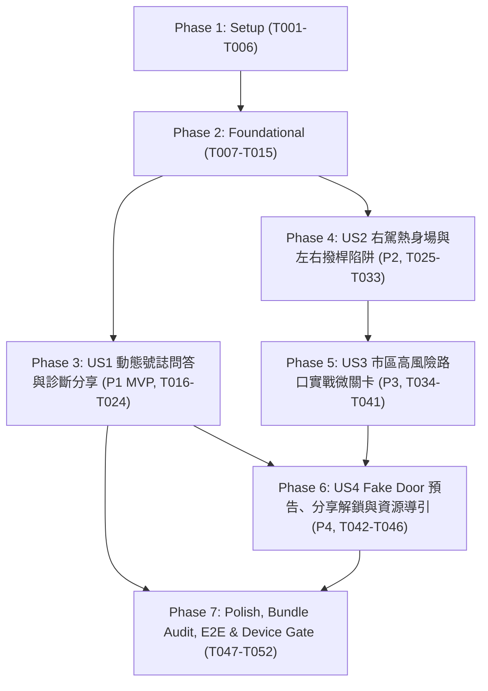

---

description: "Task list for 台灣赴日自駕右駕認知與號誌演練工具 (001-japan-rhd-trainer)"
---

# Tasks: 台灣赴日自駕右駕認知與號誌演練工具 (Japan Right-Hand-Drive Pre-Trip Cognitive Trainer)

**Input**: Design documents from `/specs/001-japan-rhd-trainer/`

**Prerequisites**: [plan.md](./plan.md) (required), [spec.md](./spec.md) (required for user stories), [research.md](./research.md), [data-model.md](./data-model.md), [contracts/telemetry-events.md](./contracts/telemetry-events.md), [contracts/ui-share-and-iab.md](./contracts/ui-share-and-iab.md), [quickstart.md](./quickstart.md)

**Tests**: 依專案憲章原則 V（`Traffic-Rule Correctness & Test-First Verification`）與強制發布品質閘門規定，所有 `src/domain/` 日本交通規則狀態機、計分模組與 `src/telemetry/` 零個資白名單過濾器**必須**撰寫 Vitest 單元測試（先寫測試並確認紅燈失敗後再實作），並於最終階段補齊 Playwright 行動端與模擬 In-App Browser 端對端測試。

**Organization**: 任務依 4 個使用者故事（`US1`–`US4`，優先級 `P1`–`P4`）分階段組織，確保每個階段皆可獨立實作、獨立測試並作為增量價值交付。

## Format: `[ID] [P?] [Story] Description`

- **[P]**: 可平行執行（修改不同檔案，且不依賴尚未完成之同階段任務）
- **[Story]**: 所屬使用者故事標籤（`[US1]`, `[US2]`, `[US3]`, `[US4]`；僅用於 User Story 階段）
- 每一任務皆明確標註專案根目錄相對檔案路徑，並逐字引用 `data-model.md` 與 `contracts/` 之欄位驗證約束

## Path Conventions

- **Single Mobile-First Web/PWA Project**: 根目錄設定檔、`public/`、`src/`（細分為 `content/`, `domain/`, `platform/`, `telemetry/`, `ui/`, `scene3d/`, `styles/`）與 `tests/`（細分為 `unit/`, `e2e/`）
- **Windows PowerShell 執行提示**：若本機 PowerShell 阻擋 `.ps1`，執行腳本時請使用 `npm.cmd`（如 `npm.cmd install`、`npm.cmd run test:unit`）

---

## Phase 1: Setup (Shared Infrastructure)

**Purpose**: 建立 TypeScript + Vite + Preact + Three.js + Vitest/Playwright 單一靜態前端專案骨架與建置設定

- [X] T001 Create project directory skeleton (`public/icons`, `src/styles`, `src/content`, `src/domain`, `src/platform`, `src/telemetry`, `src/ui`, `src/scene3d`, `tests/unit`, `tests/e2e`) and initialize `package.json` with `preact`, `three`, `@types/three`, `typescript`, `vite`, `@preact/preset-vite`, `vite-plugin-pwa`, `vitest`, and `@playwright/test` in `package.json`
- [X] T002 [P] Configure strict TypeScript compiler options (`ES2022` target, `"jsxImportSource": "preact"`, `"strict": true`, no unused locals) in `tsconfig.json`
- [X] T003 [P] Configure Vite bundler with Preact preset, `vite-plugin-pwa` static precache, and manual chunk splitting isolating `three` and `src/scene3d/` from the initial `< 60 KB` entry bundle in `vite.config.ts`
- [X] T004 [P] Configure Vitest unit test runner for deterministic domain/platform tests in `vitest.config.ts` and Playwright mobile viewport (`iPhone 14` / `Pixel 7` + custom IAB User-Agent) config in `playwright.config.ts`
- [X] T005 [P] Create mobile-first HTML shell with viewport meta (`width=device-width, initial-scale=1, maximum-scale=1, user-scalable=no, viewport-fit=cover`), Traditional Chinese metadata, and root mount node in `index.html`
- [X] T006 [P] Create global CSS variables (`--app-height`), safe-area padding (`max(12px, env(safe-area-inset-bottom))`), IAB gesture locks (`overscroll-behavior: none; touch-action: none; user-select: none; -webkit-touch-callout: none;`), and `>= 48px x 48px` touch target utility classes in `src/styles/global.css`

---

## Phase 2: Foundational (Blocking Prerequisites)

**Purpose**: 完成所有使用者故事共用之核心領域型別、LINE/FB 內建瀏覽器防護層、安全本機儲存、合成音效解鎖、零個資匿名埋點與行前免責閘門

**⚠️ CRITICAL**: 本階段完成前，不得開始任何 User Story 實作

- [X] T007 Define all shared TypeScript interfaces and literal union types in `src/domain/types.ts` matching `data-model.md` verbatim (`SignalCategory`: `'horizontal-order' | 'arrow-signal' | 'red-no-turn' | 'stop-sign' | 'pedestrian-yield'`, `MistakeType`: `'wiper-mistrigger' | 'tomare-rolling-stop' | 'wrong-way-lane' | 'signal-violation' | 'yield-violation'`, `DiagnosticGrade`: `'S' | 'A' | 'B' | 'C'`, `ConfidenceRating`: `'much-more-confident' | 'slightly-more-confident' | 'unchanged' | 'less-confident'`, `SignalScenarioQuestion`, `DrivingDrillScenario`, `RuleMistakeRecord`, `QuizSessionResult`, `DrillAttemptSummary`, `ReadinessDiagnosticCard`, `ThemePackUnlockState`, and `AnonymousValidationSession`)
- [X] T008 [P] Write unit tests for `SafeStorage` fallback (`jrhd_v1_session` persistence + private-mode in-memory `Map` fallback when `localStorage` throws) and Zero-PII `TelemetryClient` allowlist stripping (rejecting PII keys, raw `userAgent`, coordinates, or free text) in `tests/unit/telemetry-privacy.test.ts`
- [X] T009 [P] Implement `SafeStorage` (`jrhd_v1_session` JSON read/write with `try/catch` in-memory `Map` fallback and UUID v4 `sessionId` initialization) in `src/platform/safe-storage.ts`
- [X] T010 [P] Implement In-App Browser environment detector classifying `'line-iab' | 'fb-iab' | 'ig-iab' | 'safari' | 'chrome' | 'other'` and viewport class `'compact' | 'standard' | 'wide'` without exposing raw `navigator.userAgent` in `src/platform/iab-detect.ts`
- [X] T011 [P] Implement `viewport-guard` synchronizing `window.visualViewport` / `window.innerHeight` to `--app-height`, blocking multi-touch pinch/pull-to-refresh during active drills, and emitting pause callbacks on `document.visibilitychange` (`hidden`), `window.blur`, or orientation change in `src/platform/viewport-guard.ts`
- [X] T012 [P] Implement zero-asset Web Audio API synthesizer (`unlockAudioOnFirstGesture`, turn-signal tick, dry wiper squeak, warning chime, and pass chime) with silent no-op fallback when audio is blocked in `src/platform/audio-synth.ts`
- [X] T013 Implement Zero-PII `TelemetryClient` enforcing the 14-event schema (`app_first_interactive`, `disclaimer_accepted`, `quiz_started`, `quiz_completed`, `drill_started`, `rule_mistake_logged`, `drill_completed`, `core_loop_completed`, `confidence_pulse_submitted`, `diagnostic_shared`, `buddy_unlock_granted`, `fake_door_clicked`, `affiliate_resource_clicked`, `render_degraded`) via `navigator.sendBeacon` with `fetch(..., { keepalive: true })` and in-memory debug fallback in `src/telemetry/telemetry-client.ts` (depends on T007, T008, T010)
- [X] T014 [P] Implement mandatory pre-trip educational safety disclaimer modal (`disclaimerAcceptedAt` gate requiring acknowledgment before any quiz or drill, unlocking Web Audio on confirm, and emitting `disclaimer_accepted`) in `src/ui/DisclaimerModal.tsx`
- [X] T015 Wire entry bootstrap (`--app-height` init, strict whitelist URL query check `ref === 'buddy'` setting `entryRef: 'buddy-share'`, and `app_first_interactive` timing measurement) in `src/main.tsx`

**Checkpoint**: 基礎建設與零個資防護測試全數就緒，可開始依序或平行開發各 User Story

---

## Phase 3: User Story 1 - 日本差異號誌動態判讀與行前診斷分享 (Priority: P1) 🎯 MVP

**Goal**: 讓台灣旅客免安裝開啟網頁並確認免責提醒後，於 1–2 分鐘內完成 8–10 題台日差異動態交通號誌問答、獲得即時日本法規解析，並產出可長按存圖與四階降級分享至 LINE 群組之「赴日右駕存活／翻車診斷卡」。

**Independent Test**: 開啟首頁（含 `/?ref=buddy` 歡迎橫幅測試），不載入任何 Three.js 3D 模組即可獨立完成免責確認、8–10 題動態號誌作答、逐題解析檢視、Canvas 診斷卡渲染與 LINE／剪貼簿分享觸發。

### Tests for User Story 1 ⚠️

> **NOTE: 依憲章原則 V，請先撰寫以下單元測試並確認失敗（Red），再實作對應 `src/domain/` 模組（Green）**

- [X] T016 [P] [US1] Write unit tests for Japanese traffic signal evaluation (horizontal green-left/red-right, main `'red'` + lower `'left' | 'straight' | 'right'` green arrow priority, strict `'red'` with no arrows forbidding all turns, `'tomare'` full-stop rule, and crosswalk pedestrian yield) and question bank schema validation (`^sig-\d{2}-[a-z0-9-]+$`, `8..10` items covering all 5 categories) in `tests/unit/signal-evaluator.test.ts`
- [X] T017 [P] [US1] Write unit tests for quiz result aggregation (`correctCount`, `weakCategories`) and `ReadinessDiagnosticCard` grading (`'S' | 'A' | 'B' | 'C'` where any wrong-way or red-light violation caps grade at `'B'`/`'C'`, max 3 `topBlindSpots`, and XSS-safe `shareText`) in `tests/unit/diagnostic-scorer.test.ts`

### Implementation for User Story 1

- [X] T018 [P] [US1] Implement pure signal rule evaluator (`canEnterIntersection`, option validation, and question-bank invariant checker) in `src/domain/signal-evaluator.ts`
- [X] T019 [P] [US1] Implement quiz scorer and `ReadinessDiagnosticCard` builder (`grade`: `'S' | 'A' | 'B' | 'C'`, `headline`, `quizScoreText`, max 3 `topBlindSpots`, and `shareText` with `/?ref=buddy` URL) in `src/domain/diagnostic-scorer.ts`
- [X] T020 [US1] Author 10 curated Taiwan-vs-Japan animated traffic-signal questions (`id` matching `^sig-\d{2}-[a-z0-9-]+$`, `order` `1..10`, covering all 5 categories `'horizontal-order' | 'arrow-signal' | 'red-no-turn' | 'stop-sign' | 'pedestrian-yield'`, `auxiliarySign` `'tomare' | 'one-way' | 'none'`, 3–4 `options` with exactly 1 `correctOptionId`, and Traditional Chinese `ruleExplanation`) in `src/content/signal-questions.ts` (depends on T018)
- [X] T021 [P] [US1] Implement native HTML5 Canvas 2D diagnostic card renderer outputting a crisp mobile PNG Data URL (`` for IAB long-press save) in `src/platform/diagnostic-canvas.ts`
- [X] T022 [P] [US1] Implement 4-tier share client (`https://line.me/R/share?text=...` deep link -> `navigator.share` ignoring `AbortError` -> `navigator.clipboard.writeText` + hidden `<textarea>` fallback, emitting `diagnostic_shared`) in `src/platform/share-client.ts`
- [X] T023 [US1] Build SVG animated Japanese traffic-signal renderer (supporting horizontal green-left/red-right housing, lower arrow signal row `矢印式信号機`, `止まれ` sign, and multi-keyframe `signalPhases` animation) and interactive 10-question quiz flow with per-question rule explanation in `src/ui/SignalQuizView.tsx` (depends on T018, T020)
- [X] T024 [US1] Build `src/ui/DiagnosticCardView.tsx` (rendering PNG `` with long-press save hint, LINE share button, and system/clipboard share button) and wire Landing + `?ref=buddy` welcome banner + Disclaimer gate + Quiz + Diagnostic Card flow (plus idle background preload hook for `src/scene3d/`) in `src/ui/App.tsx` (depends on T014, T019, T021, T022, T023)

**Checkpoint**: User Story 1（P1 MVP 核心漏斗）已可獨立運行、測試與部署驗證，且首屏完全不依賴 Three.js

---

## Phase 4: User Story 2 - 第一人稱右駕駕訓熱身場與左右撥桿反射訓練 (Priority: P2)

**Goal**: 提供風格化低多邊形第一人稱右駕座艙「駕訓熱身場」，具備左前車頭空間參考線、半輔助轉向容錯、以及「右側方向燈 vs 左側誤觸雨刷乾刷（含靜音等效動畫橫幅）」肌肉記憶反射演練，並內建 WebGL 異常時之簡化 2D 降級視圖。

**Independent Test**: 從首頁或問答結算進入「駕訓熱身場」（含手機靜音狀態測試），獨立驗證右駕座艙視角、左側撥桿誤觸雨刷乾刷動畫＋文字提示＋失誤計數、右側方向燈觸發、半輔助轉向不卡牆完成左轉小彎與右轉大彎，以及 WebGL 停用時自動降級至 2D 視圖完課。

### Tests for User Story 2 ⚠️

- [X] T025 [P] [US2] Write unit tests for `evaluateLeverInput` (`'left'` triggering `'wiper-mistrigger'` without satisfying turn signal; `'right'` arming turn signal), semi-assisted lateral clamping within `maxLateralOffsetMeters`, and warmup checkpoint progression in `tests/unit/lever-evaluator.test.ts`

### Implementation for User Story 2

- [X] T026 [P] [US2] Implement pure lever-reflex and semi-assisted corridor evaluator (`evaluateLeverInput`, lateral offset clamping with `autoRecenterStrength`, and warmup turn-lane check requiring `'left-inbound'`) in `src/domain/lever-evaluator.ts`
- [X] T027 [P] [US2] Create `'warmup-range'` scenario configuration (`tier: 'warmup'`, `targetDurationSec` within `45..120`, ordered `checkpoints`: `'keep-left-corridor'`, `'left-turn-small'`, `'right-turn-wide'` targeting `'left-inbound'`, and `semiAssistBounds`) in `src/content/drill-scenarios.ts`
- [X] T028 [P] [US2] Implement Three.js WebGL2 engine wrapper using named ESM imports (`WebGLRenderer`, `Scene`, `PerspectiveCamera`), `pixelRatio` capped at `Math.min(window.devicePixelRatio, 2)`, `webglcontextlost` / low-FPS (`< 15 FPS` for 2s) detection emitting `render_degraded`, and pause/resume loop in `src/scene3d/DrillEngine.ts`
- [X] T029 [P] [US2] Implement stylized low-poly first-person right-hand-drive cabin mesh (right-side steering wheel, left-hood spatial guide marker, animated 3D windshield wiper blades, and dashboard turn-signal indicator) in `src/scene3d/RightSeatCockpit.ts`
- [X] T030 [US2] Implement parametric low-poly road, left-lane center guides, intersection markings, and `InstancedMesh` street blocks (`< 60` draw calls, unlit/Lambert materials, zero external textures) in `src/scene3d/RoadBuilder.ts` (depends on T027, T028)
- [X] T031 [P] [US2] Implement high-contrast simplified 2D top-down/cockpit fallback drill view so devices without WebGL can complete all checkpoints with identical rule evaluation in `src/scene3d/Fallback2DView.tsx`
- [X] T032 [P] [US2] Build cockpit touch HUD (`>= 48px x 48px` left wiper stalk trap & right turn-signal stalk, accelerate/brake hold button with stop-timer indicator, left-inbound vs right-oncoming turn selector, windshield wiper overlay animation, and high-contrast silent-mode alert banners) in `src/ui/CockpitHud.tsx`
- [X] T033 [US2] Build `src/ui/DrillContainerView.tsx` dynamically loading `src/scene3d/DrillEngine.ts` (falling back to `Fallback2DView.tsx`), integrating `viewport-guard` pause overlay, `audio-synth`, `lever-evaluator`, and emitting `drill_started`, `rule_mistake_logged`, `drill_completed`, and `core_loop_completed` in `src/ui/DrillContainerView.tsx`, then wire warmup route into `src/ui/App.tsx` after `T024` (depends on T024, T026, T028, T029, T030, T031, T032)

**Checkpoint**: User Stories 1 與 2 皆可獨立完課，使用者可在 3–5 分鐘內完成「動態號誌問答＋第一人稱駕訓熱身場」首套核心體驗

---

## Phase 5: User Story 3 - 日本市區高風險路口第一人稱實戰微關卡 (Priority: P3)

**Goal**: 新增日本典型市區高風險實戰微關卡（`urban-drill-1` 預設開放、`urban-drill-2` 結構就緒），實作「止まれ」完全靜止滿 `1000ms` 狀態機、上下排箭頭號誌多車道右轉禮讓對向直行車與斑馬線行人、誤入右側逆向車道即時攔截重試，以及首次 vs 重複挑戰失誤降幅對照與 1 題行前信心自評結算頁。

**Independent Test**: 直接進入 `urban-drill-1`，獨立驗證「止まれ」滑行未停滿 1 秒違規、對向直行車／斑馬線行人未禮讓違規、右轉切入右側對向車道逆向攔截說明，以及第 2 次重玩通過後於結算畫面正確顯示錯誤減少百分比（含首次零失誤不除以零保護）與提交 1 題信心自評。

### Tests for User Story 3 ⚠️

- [X] T034 [P] [US3] Write unit tests for `止まれ` stop-sign state machine (`Approaching` within `15m`, `StoppedAtLine` when speed `<= 0.2 km/h` and `0..4m` before stop line, `FullStopValidated` only after `>= 1000ms` continuous stop, reset to `Approaching` if speed `> 0.5 km/h` early, and `ViolationRollingStop` on crossing line unvalidated) in `tests/unit/stop-sign-evaluator.test.ts`
- [X] T035 [P] [US3] Write unit tests for urban multi-lane right-turn evaluator (arrow-signal check, yielding to oncoming straight cars and crosswalk pedestrians, `'left-inbound'` pass vs `'right-oncoming'` `'wrong-way-lane'` intercept) and `errorReductionPctVsFirst` calculation (`null` on `attemptNumber === 1`, `'perfect-maintained'` / `100` when `firstAttempt.totalMistakes === 0` and current `=== 0`, and `Math.round(((firstTotal - currentTotal) / firstTotal) * 100)` otherwise) in `tests/unit/intersection-evaluator.test.ts`

### Implementation for User Story 3

- [X] T036 [P] [US3] Implement deterministic `止まれ` full-stop state machine (`<= 0.2 km/h` within `0..4m` of stop line for `>= 1000ms`, early acceleration `> 0.5 km/h` reset, and `'tomare-rolling-stop'` emission) in `src/domain/stop-sign-evaluator.ts`
- [X] T037 [P] [US3] Implement multi-lane intersection right-turn evaluator (integrating arrow-signal state, oncoming straight vehicle & crosswalk pedestrian conflict windows, `'yield-violation'` / `'signal-violation'` logging, and `'right-oncoming'` `'wrong-way-lane'` pause-and-retry trigger) in `src/domain/intersection-evaluator.ts`
- [X] T038 [US3] Add `computeDrillAttemptSummary` (including `errorReductionPctVsFirst` zero-division guard `'perfect-maintained'`) to `src/domain/diagnostic-scorer.ts` and author `'urban-drill-1'` (`tier: 'urban-core'`) and `'urban-drill-2'` (`tier: 'urban-bonus'`) checkpoints (`'tomare-stop-line'` and `'arrow-signal-right-turn'`, `targetDurationSec` `45..120`) in `src/content/drill-scenarios.ts` (depends on T036, T037)
- [X] T039 [P] [US3] Implement 3D `止まれ` road sign / two-row arrow traffic-light meshes and deterministic oncoming straight car + crosswalk pedestrian actors in `src/scene3d/TrafficActors.ts` and wire into `src/scene3d/RoadBuilder.ts`
- [X] T040 [US3] Integrate `stop-sign-evaluator`, `intersection-evaluator`, `TrafficActors`, and wrong-way trajectory comparison overlay (pausing drill and prompting checkpoint retry when entering `'right-oncoming'`) into `src/scene3d/DrillEngine.ts`, `src/scene3d/Fallback2DView.tsx`, and `src/ui/DrillContainerView.tsx` (depends on T036, T037, T038, T039)
- [X] T041 [US3] Build `src/ui/DrillSummaryView.tsx` displaying per-type mistake breakdown (`mistakesByType`), first-attempt vs current-attempt error reduction comparison, 1-question `confidencePulse` selector (`'much-more-confident' | 'slightly-more-confident' | 'unchanged' | 'less-confident'` emitting `confidence_pulse_submitted`), and replay/next buttons, wired into `src/ui/App.tsx` (depends on T038, T040)

**Checkpoint**: User Stories 1、2、3 全數具備獨立可玩與學習遷移驗證能力

---

## Phase 6: User Story 4 - 進階主題需求驗證、旅伴分享解鎖與行前自駕資源導引 (Priority: P4)

**Goal**: 建立關卡選單中心，提供「北海道冬季雪地與縱排號誌包」與「日本高速公路匝道匯入與 ETC 包」2 張零收費 Fake Door 預告卡、透過分享給同行旅伴立即免費解鎖 `urban-drill-2` 之裂變機制，以及結算頁下方明確揭露「合作推薦／外部資源」之非侵入式自駕準備連結。

**Independent Test**: 於關卡選單與結算頁獨立驗證：(1) 點擊任一進階預告卡記錄 `fake_door_clicked` 並顯示「尚在籌備統計中，本次不會收取任何費用」對話框；(2) 點擊分享給旅伴完成 LINE 分享或連結複製後，`urban-drill-2` 立即變為已解鎖可進入遊玩（若於系統分享按取消 `AbortError` 則不解鎖）；(3) 外部資源區塊具備「合作推薦／外部資源」標籤並以新分頁開啟。

### Tests for User Story 4 ⚠️

- [X] T042 [P] [US4] Write unit tests for `ThemePackUnlockState` transitions (`'urban-drill-2'` `'share-unlockable'` unlocking on completed share but remaining locked on `AbortError`; `'hokkaido-snow-pack'` and `'highway-etc-pack'` `'fake-door-preview'` keeping `unlocked: false` while incrementing `intentClickedCount`) in `tests/unit/unlock-and-storage.test.ts`

### Implementation for User Story 4

- [X] T043 [P] [US4] Implement `unlock-manager` enforcing `ThemePackUnlockState` rules (`packId`: `'urban-drill-2' | 'hokkaido-snow-pack' | 'highway-etc-pack'`, `'share-unlockable'` vs `'fake-door-preview'` where `fake-door-preview` `unlocked` is always `false`) in `src/domain/unlock-manager.ts`
- [X] T044 [P] [US4] Author static metadata for the 2 Fake Door preview packs (`'hokkaido-snow-pack'`, `'highway-etc-pack'` with expected single-unlock reference labels and zero-charge notice copy) and disclosed pre-trip self-drive external resources (`'car-rental' | 'insurance-guide' | 'checklist'`) in `src/content/preview-packs.ts`
- [X] T045 [US4] Build `src/ui/ScenarioHubView.tsx` (and export reusable `<PreviewPacksPanel />` with zero-charge feedback modal emitting `fake_door_clicked` plus `urban-drill-2` share-to-unlock card wired to `share-client` emitting `buddy_unlock_granted`) displaying playable drills (`warmup-range`, `urban-drill-1`), bonus unlock state, and Fake Door preview cards in `src/ui/ScenarioHubView.tsx` (depends on T022, T043, T044)
- [X] T046 [US4] Mount `<PreviewPacksPanel />` (Fake Door preview cards + `urban-drill-2` share-unlock CTA) onto both settlement views (`src/ui/DiagnosticCardView.tsx` and `src/ui/DrillSummaryView.tsx` per `FR-012`), add non-intrusive disclosed external resource section (explicit `合作推薦／外部資源` badge, `target="_blank" rel="noopener noreferrer"`, emitting `affiliate_resource_clicked`) to `src/ui/DrillSummaryView.tsx`, and connect full `ScenarioHubView` navigation in `src/ui/App.tsx` (depends on T024, T041, T044, T045)

**Checkpoint**: 全部 4 個 User Stories（P1–P4）功能與 30 天行為驗證埋點完整閉環

---

## Phase 7: Polish & Cross-Cutting Concerns

**Purpose**: 補齊 PWA 圖示與社群預覽資源、撰寫行動端與模擬 In-App Browser 端對端自動化測試，並執行完整建置體積與 `quickstart.md` 品質閘門驗證

- [X] T047 [P] Generate lightweight SVG/PNG app icons in `public/icons/` and LINE/FB OpenGraph link preview graphic in `public/og-preview.png`, and link OpenGraph tags + manifest metadata in `index.html` and `vite.config.ts`
- [X] T048 [P] Write Playwright mobile e2e tests for User Story 1 (`/?ref=buddy` banner, mandatory disclaimer gate, 10-question dynamic quiz, diagnostic PNG card generation, and clipboard share fallback under simulated LINE IAB User-Agent) in `tests/e2e/quiz-and-diagnostic.spec.ts`
- [X] T049 [P] Write Playwright mobile e2e tests for User Stories 2–4 (warmup left-wiper trap silent visual banner, `urban-drill-1` `止まれ` & wrong-way intercept + repeat error-reduction summary + confidence pulse, Fake Door zero-charge modal, buddy-share unlocking `urban-drill-2`, and visibility-hidden auto-pause) in `tests/e2e/drill-and-unlock.spec.ts`
- [X] T050 Audit and optimize initial entry JS/CSS bundle size (`< 60 KB` gzipped excluding lazy `three`/`scene3d` chunk) and verify `geometry.dispose()` / `material.dispose()` cleanup on drill unmount in `src/scene3d/DrillEngine.ts` and `vite.config.ts`
- [X] T051 Run full automated verification suite (`npm.cmd run test:unit`, `npm.cmd run build`, and `npm.cmd run test:e2e`) per `specs/001-japan-rhd-trainer/quickstart.md` and fix any TypeScript, test, or bundle-budget regressions across `src/` and `tests/`
- [ ] T052 Execute pre-release real-device smoke test checklist (1 iOS Safari + LINE/FB IAB and 1 Android Chrome + LINE/FB IAB, including hardware mute switch ON, WebGL2 initialization, stalk touch responsiveness, and diagnostic-card sharing per Constitution Release Gate #3) and record pass results in `specs/001-japan-rhd-trainer/quickstart.md`

---

## Dependencies & Execution Order

### Phase Dependencies

- **Phase 1: Setup (`T001`–`T006`)**: 無前置相依，可立即開始。
- **Phase 2: Foundational (`T007`–`T015`)**: 依賴 Phase 1 完成 — **阻塞所有 User Stories**。
- **Phase 3: User Story 1 (`T016`–`T024`, P1 🎯 MVP)**: 依賴 Phase 2 完成；不依賴任何其他 User Story。
- **Phase 4: User Story 2 (`T025`–`T033`, P2)**: 依賴 Phase 2 完成；`T025`–`T032`（規則測試、駕訓熱身場與 3D/2D 引擎、HUD）可與 US1 完全平行開發，僅最後一步 `T033` 掛載 `src/ui/App.tsx` 路由於 `T024` 完成後執行以避免合併衝突。
- **Phase 5: User Story 3 (`T034`–`T041`, P3)**: 依賴 Phase 4 之基礎座艙引擎（`DrillEngine.ts`、`RoadBuilder.ts`、`DrillContainerView.tsx`）擴充市區號誌、對向車／行人與結算頁。
- **Phase 6: User Story 4 (`T042`–`T046`, P4)**: 領域層（`T042`–`T044`）於 Phase 2 後即可平行開發；UI 整合（`T045`–`T046`）銜接 US1 `share-client`／`DiagnosticCardView` 與 US3 `DrillSummaryView`、`urban-drill-2`。
- **Phase 7: Polish (`T047`–`T052`)**: 依賴 Phase 3–6 完成。

### User Story Dependency Graph



### Parallel Opportunities

- **Setup 階段**：`T001` 完成後，`T002`、`T003`、`T004`、`T005`、`T006` 修改不同設定／樣式檔，可全面平行執行。
- **Foundational 階段**：`T007` 型別確立後，`T008`、`T009`、`T010`、`T011`、`T012`、`T014` 皆位於獨立檔案，可平行執行。
- **User Story 1**：測試（`T016`、`T017`）分屬不同測試檔可平行撰寫；實作（`T018`、`T019`、`T021`、`T022`）分屬 `domain/` 與 `platform/` 不同檔案，可平行執行。
- **User Story 2**：`T025`（獨立 `lever-evaluator.test.ts`）、`T026`、`T027`、`T028`、`T029`、`T031`、`T032` 皆與 US1 無共用寫入檔案，可平行推進；僅 `T033` 於 `T024` 後串入 `App.tsx`。
- **User Story 3**：`T034` 與 `T035` 測試可平行撰寫；`T036`（止まれ狀態機）、`T037`（多車道右轉評估）與 `T039`（3D 車流與行人演員）可平行實作。
- **User Story 4**：`T042`、`T043`、`T044` 可與前期 UI 工作平行準備。

---

## Parallel Example: User Story 1 & User Story 2

```text
# User Story 1 — 先平行建立純規則測試 (Red):
Task T016: "Write unit tests for Japanese traffic signal evaluation in tests/unit/signal-evaluator.test.ts"
Task T017: "Write unit tests for quiz result aggregation and ReadinessDiagnosticCard grading in tests/unit/diagnostic-scorer.test.ts"

# User Story 1 — 接著平行實作獨立領域與平台模組 (Green):
Task T018: "Implement pure signal rule evaluator in src/domain/signal-evaluator.ts"
Task T019: "Implement quiz scorer and ReadinessDiagnosticCard builder in src/domain/diagnostic-scorer.ts"
Task T021: "Implement native HTML5 Canvas 2D diagnostic card renderer in src/platform/diagnostic-canvas.ts"
Task T022: "Implement 4-tier share client in src/platform/share-client.ts"

# User Story 2 — 平行建置 3D 座艙、2D 降級視圖與觸控 HUD:
Task T028: "Implement Three.js WebGL2 engine wrapper in src/scene3d/DrillEngine.ts"
Task T029: "Implement stylized low-poly first-person right-hand-drive cabin mesh in src/scene3d/RightSeatCockpit.ts"
Task T031: "Implement high-contrast simplified 2D fallback drill view in src/scene3d/Fallback2DView.tsx"
Task T032: "Build cockpit touch HUD in src/ui/CockpitHud.tsx"
```

---

## Implementation Strategy

### MVP First (User Story 1 First-Screen Slice)

1. 完成 **Phase 1: Setup**（`T001`–`T006`）與 **Phase 2: Foundational**（`T007`–`T015`）。
2. 完成 **Phase 3: User Story 1**（`T016`–`T024`）。
3. **STOP & VALIDATE**：驗證 `< 3 秒` 首屏啟動、免責聲明、10 題台日差異號誌動態問答與診斷卡 LINE 分享可獨立運作（此時已具備最小可投放社群測試探針）。

### Full 2–3 Week Validation Slice (Incremental Delivery)

1. **Increment 1 (`US1`)**：動態號誌問答 ＋ 個人化存活診斷分享卡（首屏秒開獲客鉤子）。
2. **Increment 2 (`US2`)**：3D 駕訓熱身場 ＋ 右側方向燈／左側雨刷反向陷阱 ＋ WebGL 2D 降級保護（完成 `SC-002` 首套核心閉環）。
3. **Increment 3 (`US3`)**：日本市區高風險路口（`止まれ` 完全靜止 ＋ 上下排箭頭號誌多車道右轉大彎 ＋ 逆向攔截）＋ 重複挑戰進步率對比與信心自評（滿足 `SC-003`、`SC-004`）。
4. **Increment 4 (`US4` + `Polish`)**：北海道雪地／高速 ETC Fake Door 預告卡 ＋ 旅伴分享免費解鎖 `urban-drill-2` ＋ 合作揭露資源 ＋ 完整單元／E2E／打包體積閘門驗收（滿足 `SC-005`–`SC-007`）。

---

## Notes

- 所有標註 `[P]` 之任務皆已確認無同檔案寫入衝突且不依賴未完成任務。
- 所有 `src/domain/` 交通規則任務必須嚴格遵守憲章原則 V（零 DOM／零 Three.js 耦合，由 Vitest 100% 覆蓋測試）。
- 實作期間嚴禁引入任何按量計費地圖／街景 API、正式金流表單或手寫無引擎 Raw WebGPU Shader。

---

## Phase 8: Convergence

- [X] T053 Support explicit right-stalk turn-signal switching (`'left' | 'right' | null` off) instead of auto-selecting checkpoint direction in `src/domain/lever-evaluator.ts`, `src/ui/CockpitHud.tsx`, `src/ui/DrillContainerView.tsx`, and `tests/unit/lever-evaluator.test.ts` per FR-006 and `contracts/ui-share-and-iab.md` §2.3 (partial)
- [X] T054 Expand `tests/e2e/drill-and-unlock.spec.ts` to cover `urban-drill-1` (`止まれ` full-stop / rolling-stop validation and multi-lane arrow right turn) and `document.visibilitychange` (`hidden`) auto-pause per T049, US3/AC1, and FR-010 (partial)
- [X] T055 Guard checkpoint advancement and `tomare-rolling-stop` mistake logging with a per-checkpoint idempotency ref outside nested state updaters in `src/ui/DrillContainerView.tsx` per FR-008, FR-009, and `plan.md` DrillContainerView lifecycle (partial)
- [X] T056 Emit `diagnostic_shared` with `{ channel: 'image-save', context: 'diagnostic-card' }` on long-press / `onContextMenu` of `diagnostic-card-image` in `src/ui/DiagnosticCardView.tsx` per FR-004 and `contracts/telemetry-events.md` (partial)
